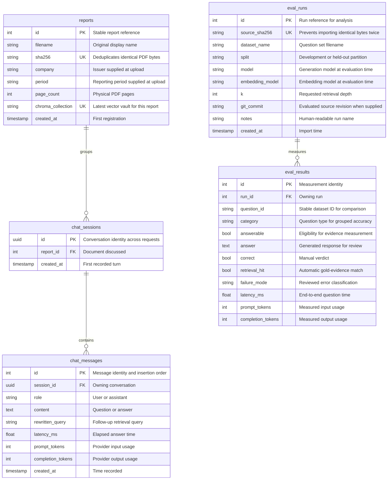

[](https://github.com/kadir-a/financial-rag-system/actions/workflows/ci.yml)

# ⚡ FinSight AI: Enterprise-Grade Financial RAG Pipeline

An end-to-end, production-oriented Retrieval-Augmented Generation (RAG) system designed for deterministic data extraction and analytical reasoning over complex financial reports (Balance Sheets, Income Statements, Cash Flow Statements).

This repository documents the architectural evolution from a standard document-QA script to a decoupled **FastAPI + Streamlit** microservices architecture, utilizing isolated environments to ensure data integrity and stateless deployment.

---

## 💼 Business Value & Market Positioning

General-purpose Large Language Models (LLMs) often struggle with numerical precision in financial contexts. FinSight AI is positioned as an **Automated Corporate Intelligence Tool** for the B2B sector:

* **Target Audience:** Investment Analysts, Credit Risk Officers, Audit Firms, and Corporate Strategy Teams.
* **Problem Statement:** Navigating 150-page annual reports is time-consuming and prone to human error. Locating specific non-current liabilities or niche financial footnotes requires significant manual effort.
* **Solution:** FinSight AI reduces retrieval time to seconds while anchoring the LLM's reasoning strictly to the source matrices (tables).

---

## 🏗️ System Architecture & MLOps (v2.0)

The monolithic structure has been refactored into a low-latency, stateless REST API architecture.

### Data Flow & Design

`Client (Streamlit) ➔ FastAPI ➔ LlamaParse (Matrix Generation) ➔ ChromaDB (Isolated Vaults) ➔ Dual-Brain RAG (GPT-4o-mini) ➔ Response`

* **Decoupled Architecture:** The UI functions as a "Dumb Client." All heavy-lifting processes—vectorization, LLM orchestration, and disk I/O—are handled by the isolated FastAPI backend.
* **Zero-Leakage Vaults:** Instead of a single persistent database, the system generates a unique, isolated `ChromaDB` collection (`vault_TIMESTAMP`) for each uploaded report. A garbage collection mechanism prunes old vaults to prevent data contamination between different corporate entities.
* **Containerized Ecosystem:** Orchestrated via `docker-compose`, the services communicate over an internal bridge network, ensuring a fully isolated production environment.

---

## 🔬 Failure Analysis & Technical Solutions

The pipeline incorporates specific countermeasures against three common failure modes in standard RAG architectures.

### 1. The Table Fracture Paradox
* **Challenge:** Conventional PDF parsers treat tables as unstructured text strings. Standard chunking often severs rows and columns, destroying the financial matrix.
* **Solution:** Integrated **LlamaParse** with `result_type="markdown"` to preserve tabular structures as aligned grids.
* **Implementation:** The `RecursiveCharacterTextSplitter` was re-configured with specialized separators: `separators=["\n\n", "\n", "|", " ", ""]`. The inclusion of `|` ensures that matrix rows remain intact during the chunking process.

### 2. Hallucination Mitigation: "Mental Math"
* **Challenge:** LLMs frequently attempt to calculate financial totals internally (mental math), leading to fabricated numerical data.
* **Solution:** Implemented a strict **System Prompt** architecture. The model is explicitly restricted from performing internal calculations, forced instead to follow Markdown `|` boundaries and extract pre-existing values directly from the source.

### 3. Context Bleed & Dual-Brain Architecture
* **Challenge:** In conversational RAG, follow-up queries (e.g., "What about 2024?") often fail vector searches because the query lacks the necessary financial keywords found in the document.
* **Solution:**
    1. **Translator Brain:** Evaluates conversational history and raw input to synthesize a standalone, optimized search query (e.g., "Total Revenue 2024").
    2. **Core Analyst Brain:** Processes the retrieved context using the user's *original* input, ensuring conversational continuity while maintaining mathematical precision in retrieval.

---

## 🛠️ Tech Stack

* **Language:** Python 3.10
* **API Framework:** FastAPI, Uvicorn
* **Frontend:** Streamlit
* **Orchestration:** LangChain, OpenAI (`gpt-4o-mini`)
* **Parsing:** LlamaParse (LlamaIndex)
* **Vector DB:** ChromaDB
* **Deployment:** Docker & Docker Compose

---

## 🚀 Installation & Quick Start

The system is fully containerized. Docker is the only requirement.

**1. Clone the repository:**
```bash
git clone https://github.com/kadir-a/financial-rag-system.git
cd financial-rag-system
```

**2. Configure Environment Variables:**
Copy `.env.example` to `.env`. Configure the PostgreSQL variables described in the Database section and set your API keys:
```env
OPENAI_API_KEY=your_openai_key
LLAMA_CLOUD_API_KEY=your_llama_cloud_key
```

**3. Build and Launch:**
```bash
docker compose up -d --build
```

**4. Access:**
* **Frontend:** `http://localhost:8501`
* **API Documentation (Swagger):** `http://localhost:8000/docs`

---

## RAG evaluation

Run the same RAG services as the backend against a single verified financial
report. Use a local `.env` with the API keys configured as described above.
Create a UTF-8 JSONL file with one question per line. Each row needs `id`,
`category`, `report` (the exact PDF filename), `split` (`dev` or `test`),
`question`, `expected_answer`, `answerable`, and `gold_evidence`. Add
`source_page` for answer review and `history` as a list of `[role, message]`
pairs for follow-up questions. Check expected answers and their currency,
scale, and period against the PDF. For questions without an answer in the
report, use an empty evidence list and record the expected abstention.

```bash
python -m eval.evaluate --pdf report.pdf --dataset eval/dataset.jsonl --split dev --k 5 --output eval/results/dev-k5.json
```

The JSON records the answer, rewritten query, retrieved text, timings, and
chat token counts when reported by the provider. It summarizes retrieval
hit rate and latency. A retrieval hit requires one retrieved chunk to
contain all listed evidence fragments. Use distinctive text from one
source passage for this check. Review answer correctness and failure mode
against the PDF, especially for ambiguous periods, incorrect scales, and
unsupported answers. Keep result files local if they contain private data.

### Arçelik pilot results

Five development questions were manually scored against the source PDF. Both
runs requested up to five retrieval chunks per question.

| Metric | Baseline | Header alignment |
| --- | ---: | ---: |
| Correct answers | 4/5 | 5/5 |
| Correct evidence retrieved (answerable cases) | 4/4 | 4/4 |
| Median response latency | 1.52 s | 1.96 s |

The baseline assigned the legal-record amount to the SPK column. The raw
Markdown placed both headings one cell to the left. Aligning those headings
before generation corrected the SPK answer. The first evidence counter
missed a misspelling in the retrieved donations row. Both evidence counts
above use the revised evidence fragments. These results cover one
five-page PDF extract and one run per configuration.

### 35-question evaluation

The dataset covers two Turkish financial documents: a five-page excerpt
from Arçelik's 2025 annual report and PEKGY's Q1 2026 standalone financial
statements. Questions include exact values, period comparisons, follow-ups
with supplied chat history, and questions without an answer in the PDF.
All runs used the final Arçelik header-alignment rule and `k=5`.
Answers were graded manually against the PDFs, requiring the requested
amount, sign, period, and any explicit detail. Retrieval was measured
automatically by matching the expected text fragments within a chunk.
Questions without a source answer are excluded from retrieval counts.

| Split | Exact answers | Automatic evidence hits | Median response latency | p95 |
| --- | ---: | ---: | ---: | ---: |
| Arçelik development | 14/15 | 12/14 | 3.36 s | 39.81 s |
| PEKGY development | 10/10 | 9/9 | 1.51 s | 2.59 s |
| PEKGY held-out questions | 8/10 | 6/8 | 1.99 s | 3.55 s |
| **Total** | **32/35** | **27/31** | | |

Manual review confirmed relevant source text was retrieved for all 14
answerable Arçelik cases. The automatic check missed two rows because
the parsed wording differed from the PDF. One Arçelik answer omitted
the start-of-year detail. On the PEKGY held-out split, the model used
unrelated equity-table values for an inventory comparison, and it
reported TL 9,553,380,230 for total equity instead of TL 9,552,280,230.
The exact expected evidence was absent from the retrieved text in both
cases. All four questions without an answer in the PDFs were handled
correctly.

The held-out split contains new questions on PEKGY, which also appears
in development. The sample covers two PDFs and one run per split, so the
results describe this benchmark. Latency excludes PDF ingestion and
embedding the document. The Arçelik developer-run p95 was the slowest
question in that small sample. For future analysis, compare the indexed
text with the PDF to distinguish parsing issues from retrieval misses,
and require support from the requested table before returning a value.

## Database

PostgreSQL 16 stores report metadata, conversations and evaluation measurements.
Chroma stores the searchable document chunks. The API keeps its existing single
active report. Each Streamlit conversation supplies a UUID. HTTP clients can
reuse the session cookie across turns or send a UUID in the optional
`session_id` field. Start a new conversation with a new UUID. The default
`/ask/` response body contains only `answer`.



A unique constraint on `(run_id, question_id)` permits one observation per
question per run. Foreign-key and timestamp indexes support joins and time
filters. Deleting a conversation or evaluation run cascades to its child rows.
Missing grades, measurements and historical model metadata stay NULL.
Upload accepts optional multipart fields `company` and `period`. Unavailable
PDF page counts also stay NULL. A repeated upload refreshes the vault
reference while preserving the report ID and its existing conversations.

### Start and migrate

Copy `.env.example` to `.env`. Set both provider keys and choose
`POSTGRES_USER`, `POSTGRES_PASSWORD` and `POSTGRES_DB`.
Set `DATABASE_URL` to
`postgresql+psycopg://<user>:<URL-encoded-password>@postgres:5432/<database>`
using those values. Choose URL-safe names and percent-encode reserved characters
in credentials in the URL. The PostgreSQL image uses the raw password.
The named volume retains the database across container restarts.

```sh
docker compose up -d --build
docker compose ps
docker compose exec backend alembic current
docker compose exec backend alembic upgrade head
```

Compose waits for the database health check on initial startup. The backend
runs the migration before starting Uvicorn. During service, each successful
upload or question uses a short database transaction. A failed write rolls
back and logs a warning. The answer is still served. Missed turns during an
outage are not replayed. A subsequent successful turn can register its report.
For development access from the host, start with
`docker compose -f docker-compose.yml -f docker-compose.dev.yml up -d`.
This publishes PostgreSQL only on `127.0.0.1:5432`.

### Import and inspect a benchmark

Keep raw files in `eval/results/`. The commands mount that directory read-only
for the importer. The 35 reviewed question grades live in `eval/grades.csv`.
The importer takes category and answerability from the matching dataset and
stores selected metrics. Retrieved passages remain in the local JSON.

```sh
docker compose run --rm -v "./eval/results:/import:ro" backend python -m eval.import_results /import/dev-k5-15.json --dataset eval/arcelik-dev.jsonl --run-name arcelik-dev --grades eval/grades.csv
docker compose run --rm -v "./eval/results:/import:ro" backend python -m eval.import_results /import/pekgy-dev-k5.json --dataset eval/pekgy-eval.jsonl --run-name pekgy-dev --grades eval/grades.csv
docker compose run --rm -v "./eval/results:/import:ro" backend python -m eval.import_results /import/pekgy-test-k5.json --dataset eval/pekgy-eval.jsonl --run-name pekgy-held-out --grades eval/grades.csv
docker compose exec backend python -m eval.report
docker compose exec backend python -m eval.report --run-id 3
```

Use IDs printed by the importer. Reimporting identical bytes reuses the run
and applies matching CSV grades. Omit `--grades` to keep the verdicts in the
source artifact. Use the original unchanged JSON and a separate CSV to revise
grades. Apply a CSV only to runs reviewed with those labels. To compare two
revisions of the same dataset and split, pass both `--baseline-id` and
`--run-id`. All seven parameterized queries are in `sql/analysis.sql`.

Examples from the three original artifacts, imported into PostgreSQL 16:

| Run | Questions | Correct / graded | Automatic hits / answerable | SQL p50 (ms) | SQL p95 (ms) |
| --- | ---: | ---: | ---: | ---: | ---: |
| Arçelik dev | 15 | 14/15 | 12/14 | 3357.14 | 28642.63 |
| PEKGY dev | 10 | 10/10 | 9/9 | 1590.87 | 2577.89 |
| PEKGY held-out | 10 | 8/10 | 6/8 | 1987.26 | 3404.35 |

```sql
SELECT COUNT(*) FILTER (WHERE retrieval_hit) AS hits, COUNT(*) AS answerable
FROM eval_results WHERE answerable;
-- hits = 27, answerable = 31 (three-run database)

SELECT failure_mode, COUNT(*) FROM eval_results
WHERE correct IS FALSE GROUP BY failure_mode ORDER BY COUNT(*) DESC;
-- retrieval_miss = 2, incomplete_answer = 1
```

The original JSON has 35 blank manual verdicts. The approved CSV supplies
32 correct answers and three failures. All 35 questions have grades. The SQL
accuracy is 32/35 (91.43%), matching the manual benchmark. PostgreSQL uses interpolated
`percentile_cont`, whereas the historical evaluator selects nearest-rank
observations. This accounts for the latency differences between the two tables.

Fast storage tests run migrations on SQLite. The PostgreSQL driver is installed
in the Docker image and PostgreSQL CI job. Windows users can keep local tests
on SQLite and run database commands inside Docker.

## 🚧 Limitations & Roadmap (WIP)

While functional, this pipeline is in active development to address the following technical benchmarks:

* **Analytical Reasoning:** Current reliance on `gpt-4o-mini` is sufficient for retrieval but requires upgrading for complex multi-step financial growth analysis.
* **Quantitative Execution:** The roadmap includes integrating a **Pandas Agent** or **Python REPL** to shift from text-based reading to deterministic mathematical execution over retrieved matrices.
* **Multi-Document Synthesis:** Future iterations will allow cross-referencing multiple historical reports within a single isolated vault.


## Testing

Use a Python 3.10 virtual environment. Install dependencies once, then run the offline suite without API keys.

```bash
pip install -r requirements.txt -r requirements-dev.txt
ruff check
pytest -q --cov=app --cov=eval
```
